# Architecture

Dota 2 posts game state to a local receiver. A rule engine turns state changes into events, and the events run actions: sound, lights and webhooks.

This covers the live flow only (ingress, rule engine, actions). Rule compilation at startup, the editor, sharing, packs and chat translation are not shown.

```mermaid
flowchart LR
    dota["Dota 2 client<br/>GSI, ~1 frame/s"]

    subgraph soundbo["Soundbo"]
        direction LR

        subgraph ingress["Ingress"]
            http["http_server<br/>aiohttp, POST /"]
        end

        queue(["asyncio.Queue<br/>interface"])

        subgraph engine["Rule engine"]
            direction TB
            ingest["ingest task<br/>single writer of state"]
            state["GameState<br/>StateSnapshot: items, abilities,<br/>hero, player, map"]
            monitors["Monitors<br/>item, ability, midas, map,<br/>hero, periodic, once"]
            ingest -->|"update(data)"| state
            state -->|snapshot| monitors
        end

        bus(["EventBus<br/>interface, sync, key = rule id"])

        subgraph actions["Actions"]
            light["LightExecutor<br/>sets lights, no I/O"]
            sound["SoundExecutor<br/>skips initial events"]
            webhook["WebhookExecutor<br/>per-URL cooldown"]
            soundq(["queue"])
            webhookq(["queue"])
            arbiter["LightingArbiter<br/>commits once per update<br/>Tapo / Tuya / log"]
            player["SoundManager<br/>pygame playback"]
            post["HTTP POST<br/>to the webhook URL"]
            light -->|"set (sync)"| arbiter
            sound --> soundq -->|worker| player
            webhook --> webhookq -->|worker| post
        end

        http -->|put| queue -->|get| ingest
        monitors -->|"emit / retract"| bus
        bus -->|handler| light
        bus -->|handler| sound
        bus -->|handler| webhook
    end

    dota -->|POST| http
```

## Notes

- **Interfaces.** The queue and the bus belong to neither side. The queue keeps the HTTP handler from touching state. The bus is a synchronous topic router that knows nothing about actions.
- **No I/O in the update.** Lights are set on the arbiter in the same call. Sound and webhook work goes onto their own queues, drained by workers, so a state update never waits on audio or network.
- **First-look events.** A monitor's first update after startup, reload or match change is marked initial. Sound skips those; lights and webhooks still run.
